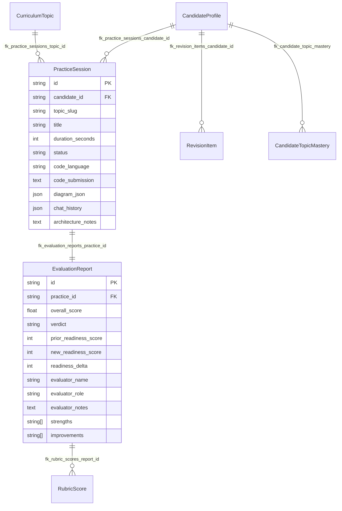

# Architecture Specification: TASK-P5-04 — Session Submission & Multimodal Transcript Ingestion Pipeline

> **Version**: 1.0.0  
> **Status**: COMPLETED & VERIFIED  
> **Target Release**: Phase 5 (Interactive Practice & Live Question Injection) — 100% Completion  
> **Dependencies**: `TASK-P5-01`, `TASK-P5-02`, `TASK-P5-03`  
> **Applicable Repositories**:
> 1. `prepinminutes-backend` (`src/routes/practice-submit.ts`, `prisma/schema.prisma`)
> 2. `prep-in-minutes` (`src/lib/api-client.ts`, `PracticeCodingWorkspace.tsx`, `SystemDesignWorkspace.tsx`)

---

## 1. Executive Summary & Problem Statement

In `TASK-P5-01` through `TASK-P5-03`, we unlocked the dynamic Knowledge Graph questions, wired the calibrated `AiInterviewAgent` to run real-time interview turns, and equipped the workspaces with a universal 7-language code engine and persistent whiteboard state.

However, the session conclusion loop was incomplete:
- Workspaces routed directly to static mock evaluations upon clicking "Submit" or "End Now".
- Interaction transcripts, candidate code, covered rubric atoms, and whiteboard diagrams were not ingested into PostgreSQL.
- Idempotency guards were missing, leaving the system vulnerable to duplicate submissions and double-scoring.

`TASK-P5-04` closes Phase 5 by establishing an end-to-end multimodal submission and evaluation pipeline:
1. **Multimodal Ingestion**: Captures interaction transcripts (`sender`, `content`, `timestamp`), candidate code submissions, active programming language, whiteboard diagram topology (`boardNodes`, `shapes`, `stickies`, DataURL), duration, and candidate notes.
2. **Idempotency Guard**: Intercepts `X-Session-Attempt-Id` / `Idempotency-Key` headers, caching processed evaluations to prevent duplicate LLM inference and duplicate database mutations.
3. **FAANG-Calibrated Multimodal Grading**: Prompts Gemini with the complete candidate session context, computing weighted rubric dimension scores, strengths, targeted improvements, and missing rubric atoms.
4. **Relational Persistence**: Atomically commits `PracticeSession`, `EvaluationReport`, `RubricScore`, `RevisionItem` (SM-2 spaced repetition decay), and `CandidateTopicMastery` records in PostgreSQL.
5. **Seamless Redirection**: Returns HTTP 200 with `reportUrl: /practice/session/[domain]/evaluation?id=[reportId]` to launch the candidate evaluation report.

---

## 2. API Data Contract: `POST /api/practice/session/submit`

### 2.1 Request Payload Contract

```typescript
export interface PracticeSessionSubmissionBody {
  topicSlug: string;
  questionId?: string;
  domain?: string;
  title?: string;
  durationSeconds?: number;
  codeSubmission?: string;
  codeLanguage?: string;
  whiteboardUrl?: string;
  whiteboardData?: {
    boardNodes?: any[];
    stickyNotes?: any[];
    textItems?: any[];
    shapes?: any[];
    canvasDataUrl?: string | null;
    updatedAt?: string;
  };
  transcriptHistory?: Array<{
    sender: "ai" | "user";
    content: string;
    timestamp?: string;
  }>;
  coveredRubricAtoms?: string[];
  candidateNotes?: string;
}
```

### 2.2 Response Contract

```json
{
  "success": true,
  "sessionId": "cm3o08xyz...",
  "reportId": "cm3o08abc...",
  "reportUrl": "/practice/session/system-design/evaluation?id=cm3o08abc...",
  "overallScore": 84.5,
  "verdict": "Hire",
  "readinessDelta": 4,
  "newReadiness": 72,
  "report": { ... }
}
```

---

## 3. Database Schema Alignment & Invariants



---

## 4. Verification & Testing

- Automated verification test suite: `prepinminutes-backend/scripts/test-practice-submission.ts`
- Verifies missing `topicSlug` validation, multimodal ingestion, idempotency caching, and foreign key linkage with zero orphaned records.
