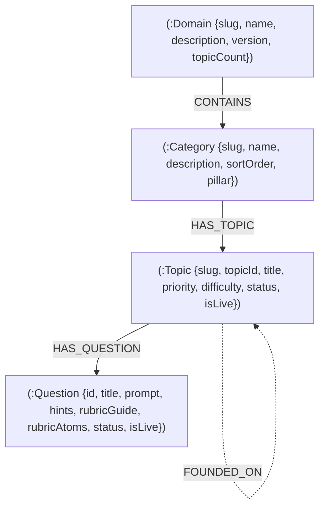
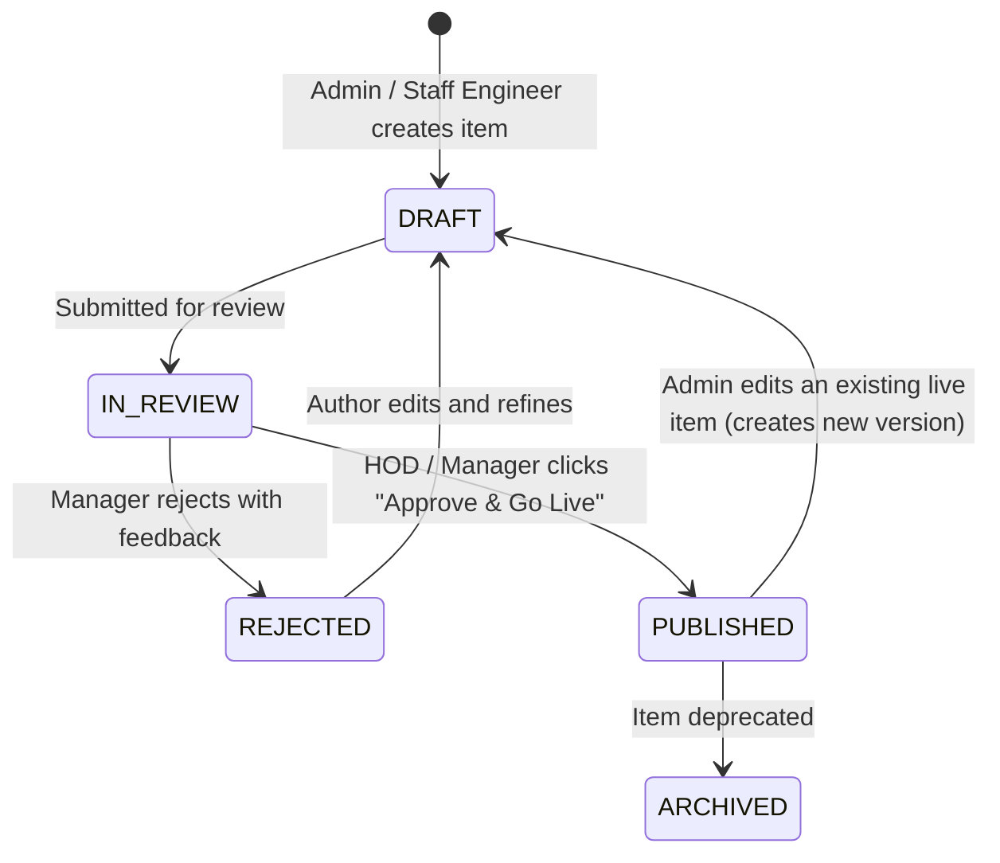
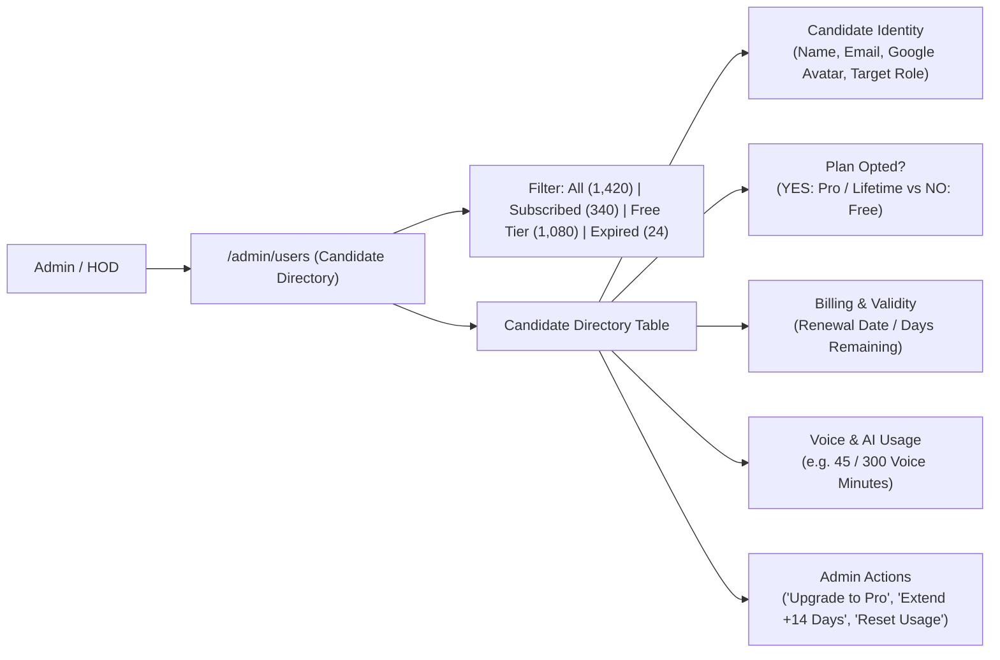
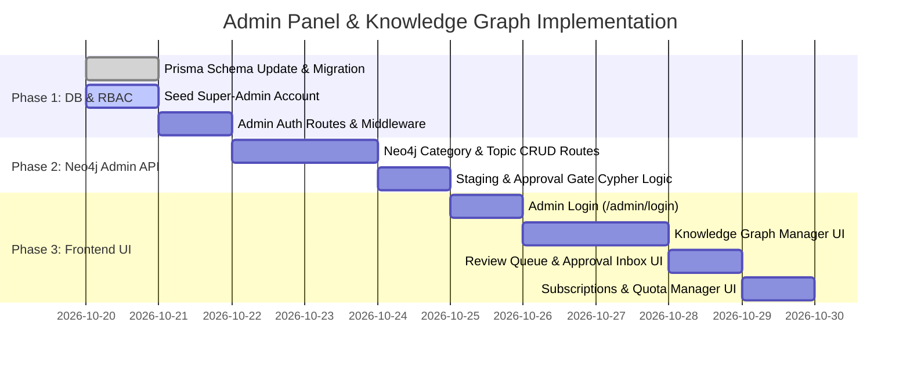

# PrepInMinutes — Admin Panel, Knowledge Graph & RBAC Specification

**Document Version:** 1.0  
**Date:** 20 October 2026  
**Status:** Approved Architectural Blueprint & Implementation Specification  
**Target Systems:** PostgreSQL (Auth & RBAC), Neo4j AuraDB (Curriculum Knowledge Graph), Next.js Frontend, Node/Express Edge API

---

## 1. Executive Summary & Architecture Philosophy

PrepInMinutes requires an **Enterprise-Grade Administrative Control Plane** (`/admin`) designed to give curriculum leads, engineering managers, and department heads direct control over the technical taxonomy, diagnostic questions, evaluation rubrics, and platform subscriptions.

### The Two-Engine Architectural Separation

To guarantee data integrity, enterprise security, and optimal traversal performance, the platform enforces a **strict architectural boundary** between relational state and graph knowledge:

```mermaid
flowchart LR
    subgraph PostgreSQL [PostgreSQL Database (Neon / Local PG)]
        direction TB
        Users["Users (Email, PBKDF2 Password Hash, Role)"]
        RBAC["RBAC Roles: SUPER_ADMIN, HOD, CURRICULUM_MANAGER, STAFF_ENGINEER"]
        Audit["Admin Audit Logs (Change history & approval trail)"]
        Billing["Subscriptions, Quotas, Usage Limits, Promo Codes"]
    end

    subgraph Neo4j [Neo4j AuraDB (Curriculum Knowledge Graph)]
        direction TB
        Domains["(:Domain) System Design, DSA, Core Languages, Behavioral"]
        Categories["(:Category) e.g. Distributed Caching, Dynamic Programming"]
        Topics["(:Topic) with status: DRAFT | IN_REVIEW | PUBLISHED"]
        Questions["(:Question) with rubric atoms, model answers, test cases"]
        DAG["Relationships: [:PREREQUISITE_OF], [:CONTAINS], [:HAS_TOPIC], [:HAS_QUESTION]"]
    end

    AdminUser["Admin UI (/admin/*)"] -->|1. Authenticate & Verify Role| PostgreSQL
    AdminUser -->|2. Direct Cypher CRUD & Approve| Neo4j
    CandidateUser["Candidate App (/practice, /ai-assessment)"] -->|Strictly Query WHERE status = 'PUBLISHED'| Neo4j
```

| Area                                        | Storage Engine | Reason for Architectural Choice                                                                                                                          |
| :------------------------------------------ | :------------- | :------------------------------------------------------------------------------------------------------------------------------------------------------- |
| **Authentication, RBAC & Passwords**        | **PostgreSQL** | Sensitive credentials, PBKDF2 salt-hash comparison, session JWTs, and transactional user records require strict ACID guarantees and row-level indexing.  |
| **Audit Logs & Billing State**              | **PostgreSQL** | Payment transactions, subscription validity, promo codes, and immutable admin edit logs require relational foreign keys and relational reporting.        |
| **Curriculum Taxonomy & Questions**         | **Neo4j**      | Reusable domain categories, topics, prerequisite DAGs (`[:PREREQUISITE_OF]`), and evaluation benchmark rubrics require high-speed graph traversals.     |
| **Publication Gating (`status`, `isLive`)** | **Neo4j**      | Allows live graph traversals to instantly filter candidate queries (`WHERE item.status = 'PUBLISHED' AND item.isLive = true`), keeping drafts invisible. |

---

## 2. PostgreSQL Role-Based Access Control (RBAC) & Authentication

### 2.1 Initial Super-Admin Seed Credentials

The system seeds the root Super-Admin administrator account into PostgreSQL:

- **Email:** `imsauravsingh@gmail.com`
- **Password:** `Saurav@3063` _(Securely hashed with PBKDF2-HMAC-SHA256, 100,000 iterations, 16-byte random salt)_
- **Role:** `SUPER_ADMIN` (Root HOD)
- **Admin Approval Status:** `APPROVED` (Permanently auto-approved root administrator)
- **Full Name:** `Saurav Singh`
- **Email Verified:** `true`

### 2.2 Role Hierarchy & Permissions Matrix

Candidates are **strictly isolated** from administrative operations. Any candidate attempting to access an `/admin` route or `/api/admin/*` API endpoint receives an immediate `403 Forbidden` response.

> [!IMPORTANT]
> **HOD Exclusive Authority on User Approvals:**
> **ONLY the HOD (`imsauravsingh@gmail.com`)** has the privilege to approve, reject, or assign administrative roles to other team members. No other user (including `CURRICULUM_MANAGER` or `STAFF_ENGINEER`) can approve new users, grant admin privileges, or modify roles.

| Permission / Operation                          | `SUPER_ADMIN` / HOD (`imsauravsingh@gmail.com`) | `CURRICULUM_MANAGER` |  `STAFF_ENGINEER`   | `CANDIDATE` (Job Seeker) |
| :---------------------------------------------- | :---------------------------------------------: | :------------------: | :-----------------: | :----------------------: |
| **Approve / Reject New Admin Users**            |                     ✅ **EXCLUSIVE**            |        ❌ No         |        ❌ No        |        ❌ Blocked        |
| **Assign / Promote Team Member Roles**          |                     ✅ **EXCLUSIVE**            |        ❌ No         |        ❌ No        |        ❌ Blocked        |
| **Revoke / Suspend Admin Access**               |                     ✅ **EXCLUSIVE**            |        ❌ No         |        ❌ No        |        ❌ Blocked        |
| **Access Admin Dashboard (`/admin`)**           |                     ✅ Yes                      |        ✅ Yes        |       ✅ Yes        |   ❌ **403 Forbidden**   |
| **Create / Edit Topics in `DRAFT`**             |                     ✅ Yes                      |        ✅ Yes        |       ✅ Yes        |        ❌ Blocked        |
| **Review Queue & Question Testing**             |                     ✅ Yes                      |        ✅ Yes        |       ✅ Yes        |        ❌ Blocked        |
| **Approve & Push to Live Neo4j (`PUBLISHED`)**  |                     ✅ Yes                      |        ✅ Yes        | ❌ No (Submit only) |        ❌ Blocked        |
| **Delete Categories / Topics / Questions**      |                     ✅ Yes                      |    ⚠️ Restricted     |        ❌ No        |        ❌ Blocked        |
| **Manage Subscriptions, Prices & Promo Codes**  |                     ✅ Yes                      |     👁️ View Only     |        ❌ No        |        ❌ Blocked        |
| **Candidate Transcript Audit & Score Override** |                     ✅ Yes                      |        ✅ Yes        |    👁️ View Only     |        ❌ Blocked        |

### 2.3 User Approval Lifecycle & Access Request Workflow

The Admin Portal supports dual authentication methods: **Google SSO (Gmail)** and **Email/Password**.

```mermaid
flowchart TD
    User["New Team Member / Reviewer"] -->|Clicks 'Sign in with Google'| GoogleAuth["Google SSO OAuth2 Flow"]
    GoogleAuth --> Backend["POST /api/admin/auth/google"]
    
    Backend --> CheckEmail{"Is email == imsauravsingh@gmail.com?"}
    
    CheckEmail -->|YES (Root HOD)| AutoActive["Set role = 'SUPER_ADMIN'<br/>Set adminApprovalStatus = 'APPROVED'<br/>Issue Full Admin Session Cookie"]
    AutoActive --> AdminDash["Direct Access to /admin Dashboard"]
    
    CheckEmail -->|NO (Other Team Members)| CheckStatus{"Is user already APPROVED?"}
    CheckStatus -->|YES| TeamDash["Direct Access with Assigned Role"]
    CheckStatus -->|NO| RequestForm["Redirect to /admin/request-access<br/>(Input: Requested Role + Required Reason Textarea)"]
    
    RequestForm -->|Submits Reason & Role| SubmitReq["POST /api/admin/auth/request-access<br/>Saves requestReason & requestedRole<br/>Set adminApprovalStatus = 'PENDING'"]
    SubmitReq --> HoldingPage["Redirect to /admin/pending-approval<br/>(Notice: Awaiting HOD imsauravsingh@gmail.com review)"]
    
    HoldingPage -.->|Waits for HOD Action| HODReview["HOD reviews in /admin/users-rbac<br/>(Reads applicant reason & requested role)"]
    HODReview -->|HOD selects role & clicks 'Approve'| ApprovedState["Set adminApprovalStatus = 'APPROVED'<br/>Set role = HOD_SELECTED_ROLE<br/>Set approvedBy = 'imsauravsingh@gmail.com'<br/>Set approvedAt = now()"]
    ApprovedState --> TeamDash
```

#### Key Rules & Experience:
1. **Root HOD Auto-Activation:**
   - `imsauravsingh@gmail.com` is **permanently auto-approved** with `role: "SUPER_ADMIN"` and `adminApprovalStatus: "APPROVED"`.
   - The HOD can log in seamlessly via **Google SSO** with 1 click or with password `Saurav@3063`.
2. **Post-Registration Access Request Screen (`/admin/request-access`):**
   - Immediately upon logging in via Google for the first time, any non-HOD user is presented with the **Access Request Form**:
     - **Google Identity Card:** Displays authenticated name, email, and Google avatar.
     - **Requested Role Selector:** Options for *Curriculum Manager*, *Staff Engineer*, *Content Reviewer*, or *Employee / Support*.
     - **Required Justification Textarea:** *"Reason for access & project responsibilities (e.g., Which topics or categories are you working on? What team are you in?)"*.
     - **Submit Request Button.**
3. **Pending Approval Holding Page (`/admin/pending-approval`):**
   - After submitting their reason, the user is transitioned to the holding screen:
     - Shows: *"Your admin request has been sent to Saurav Singh (imsauravsingh@gmail.com)."*
     - Displays their submitted reason and requested role with a `PENDING REVIEW` badge.
     - They have zero access to curriculum, questions, or admin endpoints until approved.
4. **HOD Review & Role Granting (`/admin/users-rbac`):**
   - Only Saurav (`imsauravsingh@gmail.com`) can view the **Pending Access Requests** queue.
   - For every request, Saurav sees:
     - Applicant Name, Email, Google Profile Avatar, and Timestamp.
     - The applicant's exact **written reason text**.
     - An **Assigned Role Dropdown** (allowing Saurav to grant what they asked for, or adjust it to `CURRICULUM_MANAGER`, `STAFF_ENGINEER`, or `CONTENT_REVIEWER`).
     - **"Approve & Grant Access"** and **"Reject Request"** buttons.

```prisma
enum AdminRole {
  SUPER_ADMIN
  HOD
  CURRICULUM_MANAGER
  STAFF_ENGINEER
  CONTENT_REVIEWER
  CANDIDATE
}

enum AdminApprovalStatus {
  NONE
  PENDING
  APPROVED
  REJECTED
  SUSPENDED
}

model User {
  id                  String               @id @default(cuid())
  clerkId             String?              @unique(map: "uq_users_clerk_id") @map("clerk_id")
  googleId            String?              @unique(map: "uq_users_google_id") @map("google_id")
  username            String?              @unique(map: "uq_users_username") @map("username")
  passwordHash        String?              @map("password_hash")
  email               String               @unique(map: "uq_users_email")
  emailVerified       Boolean              @default(false) @map("is_email_verified")
  fullName            String?              @map("full_name")
  avatarUrl           String?              @map("avatar_url")
  authProvider        String               @default("google") @map("auth_provider")
  role                AdminRole            @default(CANDIDATE) @map("role")
  adminApprovalStatus AdminApprovalStatus  @default(NONE) @map("admin_approval_status")
  
  // Account Status & Universal Blocking (Applies to both Candidates & Staff)
  isBlocked           Boolean              @default(false) @map("is_blocked")
  blockedReason       String?              @map("blocked_reason") // Reason for suspension / ban
  blockedAt           DateTime?            @map("blocked_at") @db.Timestamptz(6)
  blockedBy           String?              @map("blocked_by") // HOD or Admin who blocked the user
  
  // Access Request Details (for Internal Staff)
  requestedRole       String?              @map("requested_role") // "CURRICULUM_MANAGER" | "STAFF_ENGINEER" | "CONTENT_REVIEWER"
  requestReason       String?              @db.Text @map("request_reason") // Written justification for HOD review
  requestedAt         DateTime?            @map("requested_at") @db.Timestamptz(6)
  
  approvedBy          String?              @map("approved_by") // imsauravsingh@gmail.com
  approvedAt          DateTime?            @map("approved_at") @db.Timestamptz(6)
  createdAt           DateTime             @default(now()) @map("created_at") @db.Timestamptz(6)
  updatedAt           DateTime             @updatedAt @map("updated_at") @db.Timestamptz(6)

  profile             CandidateProfile?
  subscription        Subscription?
  auditLogs           AdminAuditLog[]

  @@index([role], map: "idx_users_role")
  @@index([adminApprovalStatus], map: "idx_users_admin_approval_status")
  @@index([isBlocked], map: "idx_users_is_blocked")
  @@map("users")
}

model AdminAuditLog {
  id          String    @id @default(cuid())
  userId      String    @map("user_id")
  user        User      @relation(fields: [userId], references: [id], onDelete: Cascade)
  action      String    @map("action") // "APPROVE_ADMIN_USER" | "ASSIGN_ROLE" | "REVOKE_ADMIN" | "UPDATE_CATEGORY"
  targetType  String    @map("target_type") // "User" | "Category" | "Topic" | "Question" | "Subscription"
  targetId    String    @map("target_id")
  changeDiff  Json?     @map("change_diff")
  ipAddress   String?   @map("ip_address")
  createdAt   DateTime  @default(now()) @map("created_at") @db.Timestamptz(6)

  @@index([userId, createdAt], map: "idx_admin_audit_logs_user_created")
  @@map("admin_audit_logs")
}
```

---

## 3. Neo4j Knowledge Graph Operations & Taxonomy

Neo4j is the single source of truth for **technical taxonomy, questions, and prerequisites**.



### 3.1 Domain-Specific Modeling Nuances

#### 1. Data Structures & Algorithms (DSA):

- **Core Node Attributes:**
  - `pattern`: e.g. `"Sliding Window"`, `"Monotonic Stack"`, `"Dynamic Programming (2D)"`, `"Graph (BFS/DFS)"`.
  - `timeComplexityTarget`: e.g. `"O(N)"`, `"O(N log N)"`.
  - `spaceComplexityTarget`: e.g. `"O(1)"`, `"O(N)"`.
- **Question Bank Requirements:**
  - Standard problem statement + input/output format constraints.
  - Multi-language starter templates (Python, Java, Go, TypeScript, C++).
  - Public test cases + hidden test cases for edge-case evaluation.

#### 2. System Design (HLD & Scalability):

- **Core Node Attributes:**
  - `targetLevel`: `"MID" | "SENIOR" | "STAFF" | "PRINCIPAL"`.
  - `scaleContext`: Expected QPS (e.g. 200,000 read QPS), Storage (e.g. 50TB/day), Latency SLA (e.g. p99 < 20ms).
- **Rubric Atoms Checklist:**
  - Required architectural checklist atoms (e.g., `["bloom filters", "cache aside pattern", "consistent hash ring", "probabilistic early expiration (XFetch)"]`).
  - Reference Model Architecture blueprint.

#### 3. Behavioral & Leadership:

- **Core Node Attributes:**
  - `competency`: `"Conflict Resolution"`, `"Ownership"`, `"Deliver Results"`, `"Ambiguity"`.
  - `companyFramework`: `"Amazon 16 Leadership Principles"`, `"Google Googleyness"`, `"Meta Move Fast"`.
- **Rubric Atoms Checklist:**
  - Positive indicators (Green flags) vs. Negative indicators (Red flags).
  - STAR framework enforcement (Situation, Task, Action, Result).

#### 4. Core Language Runtimes & Low-Level Design (LLD):

- **Core Node Attributes:**
  - Language stack: `"Java"`, `"Go"`, `"Python"`, `"TypeScript"`, `"C#"`, `"PHP"`.
  - Runtime mechanisms: Garbage collection, memory model (JMM), concurrency primitives, event loop phases.

---

## 4. Staging & Approval Lifecycle ("Draft" $\rightarrow$ "Live")

To ensure that only high-quality, vetted content reaches candidates, content created in the admin panel undergoes a **staging lifecycle**:



### 4.1 Cypher Schema Enforcement

Every Topic and Question node in Neo4j includes:

```cypher
(:Topic {
  slug: String,                 // Unique identifier
  title: String,
  status: "DRAFT" | "IN_REVIEW" | "PUBLISHED" | "ARCHIVED",
  isLive: Boolean,              // true ONLY if status == 'PUBLISHED'
  version: Integer,             // Increments on each published edit
  createdBy: String,            // User ID
  approvedBy: String,           // Manager / HOD User ID
  approvedAt: DateTime,
  updatedAt: DateTime
})
```

### 4.2 Candidate Query Isolation

All candidate runtime queries enforce strict filtering:

```cypher
// Candidate Practice & AI Assessment Query
MATCH (d:Domain)-[:CONTAINS]->(c:Category)-[:CONTAINS]->(t:Topic {status: 'PUBLISHED', isLive: true})
OPTIONAL MATCH (t)-[:TESTED_BY]->(q:Question {status: 'PUBLISHED', isLive: true})
RETURN d, c, t, q
```

> [!IMPORTANT]
> Unapproved drafts or items currently in review have `isLive: false` and are completely invisible to candidate assessment sessions and plan generators.

---

## 5. Subscription, Pricing & Usage Quota Management

The Admin Panel includes a dedicated **Subscriptions & Monetization** management module:

```
┌────────────────────────────────────────────────────────────────────────┐
│                        SUBSCRIPTION TIERS & LIMITS                     │
├───────────────┬───────────────────────────────────┬────────────────────┤
│ Tier Name     │ Monthly Entitlements              │ Target Audience    │
├───────────────┼───────────────────────────────────┼────────────────────┤
│ Free Tier     │ • 1 Diagnostic Assessment         │ Job Hunters        │
│               │ • 3 Practice Drills / Day         │ Exploring Platform │
│               │ • Community Roadmap               │                    │
├───────────────┼───────────────────────────────────┼────────────────────┤
│ Pro Sprint    │ • Unlimited Practice Questions    │ Active Interview   │
│ ($49/month)   │ • 10 Full AI Voice Mocks / Month  │ Candidates         │
│               │ • Detailed Diagnostic Breakdown   │ (2–6 week window)  │
├───────────────┼───────────────────────────────────┼────────────────────┤
│ Lifetime Pass │ • Unlimited Voice Sessions        │ Senior & Staff ICs │
│ ($149 one-off)│ • Priority Gemini 3.1 Reasoning   │ Long-term Career   │
│               │ • Spaced Repetition Flashcards    │ Growth             │
├───────────────┼───────────────────────────────────┼────────────────────┤
│ Enterprise /  │ • Multi-seat team licenses        │ University Cohorts │
│ Campus B2B    │ • Cohort Analytics & Leaderboards │ Bootcamps          │
└───────────────┴───────────────────────────────────┴────────────────────┘
```

### Administrative Actions Directly Handled via Admin UI:

1. **Usage Quota Adjustments:** Set maximum voice minutes per user per month (protects against Cartesia Sonic-3.6 and Deepgram Nova-2 cost runaway).
2. **Promo Codes & Discounts:** Create promo codes (e.g., `GOOGLEPREP50`), set percentage discounts, expiration dates, and maximum redemption caps.
3. **Customer Support Credit Grants:** One-click button on any candidate profile card: **"Grant +1 Free Mock Interview"** or **"Extend Pro Access by 14 Days"** (useful when resolving candidate audio/browser issues).
4. **Revenue & AI Cost Monitoring:** View Monthly Recurring Revenue (MRR), subscriber churn, and total LLM/STT/TTS API cost vs. revenue margin.

### 5.2 Candidate User Directory & Subscription Status View (`/admin/users`)

The Admin Panel includes a dedicated **Candidate & Subscriber Directory** allowing administrators to track who has opted into a paid subscription versus who is on the free tier:



#### Directory Columns & Capabilities:
1. **Candidate Profile:** Name, Email, Google Avatar, Sign-up Date, Target Role (`CandidateProfile.targetRole`).
2. **Subscription Opted Badge:**
   - 🟢 **`YES (PRO MONTHLY)`** / 🟣 **`YES (LIFETIME PASS)`** / 🔵 **`YES (CAMPUS)`**: Indicates paid customer.
   - ⚪ **`NO (FREE TIER)`**: Indicates prospective candidate exploring the platform.
   - 🟠 **`EXPIRED / PAST DUE`**: Indicates lapsed subscription.
3. **Usage & Quota Consumption Tracker:**
   - Real-time progress bar of AI voice minutes consumed (e.g. `24 / 30 mins` on Free, `120 / 300 mins` on Pro).
   - Mock interviews completed vs monthly allowance.
4. **Administrative Overrides & Customer Support:**
   - **"Grant Pro Access":** Dropdown to manually upgrade a candidate (e.g. for campus partnerships or contest winners).
   - **"Extend Subscription":** Add 7, 14, or 30 days to their current billing period.
   - **"Reset Quotas":** If a candidate experienced technical audio/network glitches, reset their monthly minutes.

### 5.3 PostgreSQL Subscription Model (`prisma/schema.prisma`)

```prisma
enum SubscriptionTier {
  FREE
  PRO_MONTHLY
  PRO_QUARTERLY
  LIFETIME
  CAMPUS_ENTERPRISE
}

enum SubscriptionStatus {
  INACTIVE
  TRIALING
  ACTIVE
  PAST_DUE
  CANCELED
  EXPIRED
}

model Subscription {
  id                     String             @id @default(cuid())
  userId                 String             @unique(map: "uq_subscriptions_user_id") @map("user_id")
  user                   User               @relation(fields: [userId], references: [id], onDelete: Cascade)
  tier                   SubscriptionTier   @default(FREE) @map("tier")
  status                 SubscriptionStatus @default(INACTIVE) @map("status")
  planName               String             @default("Free Plan") @map("plan_name")
  isPlanOpted            Boolean            @default(false) @map("is_plan_opted") // True if paid plan chosen
  pricePaid              Float              @default(0.0) @map("price_paid")
  currency               String             @default("USD") @map("currency")
  currentPeriodStart     DateTime           @default(now()) @map("current_period_start") @db.Timestamptz(6)
  currentPeriodEnd       DateTime?          @map("current_period_end") @db.Timestamptz(6)
  cancelAtPeriodEnd      Boolean            @default(false) @map("cancel_at_period_end")
  paymentProvider        String?            @map("payment_provider") // "stripe" | "razorpay" | "manual_admin"
  
  // Usage tracking
  voiceMinutesUsed       Float              @default(0.0) @map("voice_minutes_used")
  voiceMinutesLimit      Float              @default(30.0) @map("voice_minutes_limit")
  mockInterviewsUsed     Int                @default(0) @map("mock_interviews_used")
  mockInterviewsLimit    Int                @default(1) @map("mock_interviews_limit")
  
  createdAt              DateTime           @default(now()) @map("created_at") @db.Timestamptz(6)
  updatedAt              DateTime           @updatedAt @map("updated_at") @db.Timestamptz(6)

  @@index([tier, status], map: "idx_subscriptions_tier_status")
  @@index([isPlanOpted], map: "idx_subscriptions_is_plan_opted")
  @@map("subscriptions")
}
```

---

## 6. Information Architecture: Admin UI Pages & API Routes

### 6.1 Frontend Admin Routes (`/admin/*`)

| Route                    | Purpose                             | Key Components                                                                          |
| :----------------------- | :---------------------------------- | :-------------------------------------------------------------------------------------- |
| `/admin/login`           | Administrator authentication portal | Google SSO ("Sign in with Google") + Email/Password form.                               |
| `/admin/request-access`  | Post-registration access request    | Dropdown for requested role + required justification textarea for HOD review.          |
| `/admin/pending-approval`| Access holding page for new admins  | Notice informing user that access is pending HOD approval (`imsauravsingh@gmail.com`). |
| `/admin`                 | Executive Command Dashboard         | Live counts (Total Categories, Topics, Questions, Pending Approvals, MRR).              |
| `/admin/curriculum`      | Neo4j Knowledge Graph Manager       | Visual domain tree, Category CRUD modal, Topic details, Rubric atom editor.             |
| `/admin/questions`       | Master Question Bank                | Filter by category/difficulty, Markdown prompt editor, starter code & test case editor. |
| `/admin/approvals`       | Review & Staging Queue              | Side-by-side diff viewer (what changed?), one-click "Approve & Go Live".                |
| `/admin/candidates`      | Candidate & Subscriber Directory    | End-user candidates list: **Plan Opted (Yes/No)**, Plan tier, AI usage, Block Candidate.|
| `/admin/team`            | HOD Team & Staff Management         | Internal staff only: pending requests with reasons, role assignment, Block Staff Member.|
| `/admin/subscriptions`   | Pricing & Quota Management          | Plan pricing editor, promo code creator, candidate usage overrides.                     |

### 6.2 Backend Admin REST API Endpoints (`/api/admin/*`)

```http
# Authentication & Identity (PostgreSQL)
POST   /api/admin/auth/google               # Handles Google SSO authentication for admin portal
POST   /api/admin/auth/login                # Authenticates admin email & password, sets pim_admin_session
POST   /api/admin/auth/request-access       # Saves applicant's requested role and justification reason
POST   /api/admin/auth/logout               # Clears admin session
GET    /api/admin/auth/me                   # Validates admin session & returns role + approval status

# Candidate Directory & Subscription Status (PostgreSQL — Independent Route: /api/admin/candidates/*)
GET    /api/admin/candidates                # Paginated candidate list with filter (all | subscribed | free | expired | blocked)
GET    /api/admin/candidates/:id            # Detailed candidate profile, readiness score, and prep plan
PATCH  /api/admin/candidates/:id/subscription # Manually upgrade/grant subscription tier or extend validity days
POST   /api/admin/candidates/:id/block      # Blocks/suspends candidate from accessing platform (with blockedReason)
POST   /api/admin/candidates/:id/unblock    # Unblocks candidate and restores access
POST   /api/admin/candidates/:id/reset-quota # Resets monthly voice minutes for customer support resolution

# HOD Team & Staff Management (PostgreSQL — Restricted strictly to HOD: /api/admin/team/*)
GET    /api/admin/team                      # Lists active internal staff (Managers, Engineers, Reviewers)
GET    /api/admin/team/pending              # Lists pending staff access requests with applicant reason text
PATCH  /api/admin/team/:id/approve          # HOD approves staff applicant and assigns role
PATCH  /api/admin/team/:id/reject           # HOD rejects staff request
PATCH  /api/admin/team/:id/role             # HOD updates role (CURRICULUM_MANAGER, STAFF_ENGINEER, CONTENT_REVIEWER)
POST   /api/admin/team/:id/block            # HOD blocks/suspends staff member (immediate admin session termination)
POST   /api/admin/team/:id/unblock          # HOD unblocks staff member
GET    /api/admin/team/audit-logs           # Administrative action audit trail

# Curriculum & Knowledge Graph (Neo4j AuraDB)
GET    /api/admin/neo4j/categories          # Lists all domains and categories with topic counts
POST   /api/admin/neo4j/categories          # Creates a new category under a domain
PUT    /api/admin/neo4j/categories/:slug    # Updates category title, description, order
DELETE /api/admin/neo4j/categories/:slug    # Deletes category (safe check for dependencies)

GET    /api/admin/neo4j/topics              # Lists topics with filter by category & status
POST   /api/admin/neo4j/topics              # Creates a new topic (status: DRAFT)
PUT    /api/admin/neo4j/topics/:slug        # Updates topic attributes and rubric atoms
DELETE /api/admin/neo4j/topics/:slug        # Deletes or archives topic

# Staging & Approval Queue
GET    /api/admin/neo4j/pending             # Lists all items with status = 'DRAFT' or 'IN_REVIEW'
POST   /api/admin/neo4j/approve             # Sets status = 'PUBLISHED', isLive = true
POST   /api/admin/neo4j/reject              # Sets status = 'REJECTED' with reviewer comments

# Subscriptions & Pricing Plans (PostgreSQL)
GET    /api/admin/subscriptions/plans       # Lists active plans and quota limits
POST   /api/admin/subscriptions/coupons     # Creates a promotional discount code
POST   /api/admin/subscriptions/grant-credit # Grants candidate extra mock interview sessions
```

---

## 7. Implementation Roadmap



---

## 8. Summary Checklist Before Coding

- [x] Clear boundary established: PostgreSQL for Auth, Passwords, RBAC, Subscriptions; Neo4j for Knowledge Graph.
- [x] Initial Super-Admin specified: `imsauravsingh@gmail.com` with password `Saurav@3063`.
- [x] Exclusive HOD authority: ONLY `imsauravsingh@gmail.com` can approve new admin users, promote roles, or grant admin permissions.
- [x] Candidate isolation: Candidates strictly receive 403 Forbidden on admin routes and can only query `status: 'PUBLISHED'` graph nodes.
- [x] Category nuances modeled: Distinct parameters for DSA, System Design, Behavioral, and Core Languages.
- [x] Approval queue lifecycle documented with audit logging.
