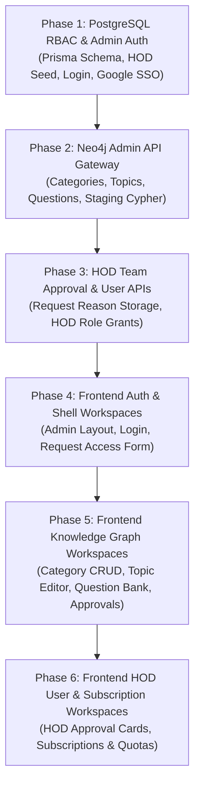

# PrepInMinutes — Admin Panel, Knowledge Graph & RBAC Task Roadmap

> **Platform Module**: Admin Control Plane & Knowledge Graph Governance  
> **Target Databases**: PostgreSQL (Auth, RBAC, Subscriptions, Audit) & Neo4j AuraDB (Curriculum Graph)  
> **Status**: Ready for Sequential Execution  

This document provides the **sequential, step-by-step implementation roadmap** for the PrepInMinutes Admin Panel, PostgreSQL Role-Based Access Control (RBAC), HOD approval workflows, Neo4j Knowledge Graph CRUD, and Subscription Management.

---

## 📌 Implementation Guidelines & Rules
1. **Mark Tasks As Done**: When a task is completed, change `- [ ]` to `- [x]` with completion timestamp.
2. **PostgreSQL vs Neo4j Boundary**:
   - All authentication, passwords, RBAC roles, user approvals, audit logs, and subscriptions reside in **PostgreSQL**.
   - All technical domains, categories, topics, questions, rubric atoms, and prerequisite edges reside in **Neo4j**.
3. **Exclusive HOD Authority**: Only `imsauravsingh@gmail.com` has permissions to approve pending admin user requests or promote roles.
4. **Candidate Staging Isolation**: Candidate queries must strictly filter `WHERE item.status = 'PUBLISHED' AND item.isLive = true`.

---

## 🚀 Sequential Task Breakdown

---

### Phase 1: PostgreSQL RBAC, Admin Authentication & HOD Auto-Activation

- [ ] **Task 1.1: PostgreSQL Prisma Schema Migration for RBAC & Access Requests**
  - **Target File**: [`prepinminutes-backend/prisma/schema.prisma`](../../prepinminutes-backend/prisma/schema.prisma)
  - **Actions**:
    - Add `enum AdminRole { SUPER_ADMIN, HOD, CURRICULUM_MANAGER, STAFF_ENGINEER, CONTENT_REVIEWER, CANDIDATE }`.
    - Add `enum AdminApprovalStatus { NONE, PENDING, APPROVED, REJECTED, SUSPENDED }`.
    - Extend `User` model with: `role`, `adminApprovalStatus`, `requestedRole`, `requestReason` (`@db.Text`), `requestedAt`, `approvedBy`, `approvedAt`.
    - Create `AdminAuditLog` model (`userId`, `action`, `targetType`, `targetId`, `changeDiff`, `ipAddress`, `createdAt`).
    - Execute `npx prisma db push` and verify client generation.
  - **Acceptance Criteria**: Database schema reflects all new fields with proper indexes on `[role]` and `[adminApprovalStatus]`.

- [ ] **Task 1.2: Seed Root HOD Account in PostgreSQL**
  - **Target File**: [`prepinminutes-backend/scripts/seed-admin-hod.ts`](../../prepinminutes-backend/scripts/seed-admin-hod.ts)
  - **Actions**:
    - Create dedicated seeder script to upsert `imsauravsingh@gmail.com`.
    - Hash password `Saurav@3063` using PBKDF2-HMAC-SHA256 (100,000 iterations).
    - Set `role = SUPER_ADMIN`, `adminApprovalStatus = APPROVED`, `emailVerified = true`.
    - Execute script and verify account exists in Neon PostgreSQL.
  - **Acceptance Criteria**: Root HOD account can be queried from PostgreSQL with verified password hash and `SUPER_ADMIN` role.

- [ ] **Task 1.3: Admin JWT Session & Security Middleware**
  - **Target File**: [`prepinminutes-backend/src/server/auth/admin-auth.ts`](../../prepinminutes-backend/src/server/auth/admin-auth.ts)
  - **Actions**:
    - Implement `signAdminSessionJwt(payload: { userId, email, role, adminApprovalStatus })`.
    - Implement `verifyAdminSessionJwt(token: string)`.
    - Implement middleware `requireAdminRole(allowedRoles: AdminRole[])` checking session and DB state.
    - Implement `requireRootHOD()` restricting endpoints exclusively to `imsauravsingh@gmail.com`.
  - **Acceptance Criteria**: Unauthorized requests or normal candidate tokens receive immediate `403 Forbidden` response.

- [ ] **Task 1.4: Admin Authentication REST API Routes**
  - **Target File**: [`prepinminutes-backend/src/routes/admin-auth.ts`](../../prepinminutes-backend/src/routes/admin-auth.ts)
  - **Endpoints**:
    - `POST /api/admin/auth/login`: Validates email and PBKDF2 password; checks `role !== CANDIDATE` and `adminApprovalStatus === APPROVED`; issues `pim_admin_session` cookie.
    - `POST /api/admin/auth/google`: Verifies Google ID token / code; if `email === "imsauravsingh@gmail.com"`, auto-activates `SUPER_ADMIN` and issues session; otherwise upserts user with `adminApprovalStatus: PENDING` and signals redirection to `/admin/request-access`.
    - `POST /api/admin/auth/request-access`: Saves applicant's `requestedRole` and `requestReason` text; sets `requestedAt = now()`.
    - `GET /api/admin/auth/me`: Returns verified admin profile, role, and approval status.
    - `POST /api/admin/auth/logout`: Clears `pim_admin_session` cookie.
  - **Acceptance Criteria**: All 5 auth endpoints tested and returning correct HTTP statuses and cookies.

---

### Phase 2: Neo4j Knowledge Graph Admin Service & REST API Gateway

- [ ] **Task 2.1: Neo4j Node Schema Constraints & Status Properties**
  - **Target File**: [`prepinminutes-backend/scripts/setup-neo4j-admin-constraints.ts`](../../prepinminutes-backend/scripts/setup-neo4j-admin-constraints.ts)
  - **Actions**:
    - Add unique constraints on `Category.slug`, `Topic.slug`, `Question.id`.
    - Ensure all existing topics/questions have default `status = "PUBLISHED"` and `isLive = true`.
  - **Acceptance Criteria**: Neo4j AuraDB schema constraints verified.

- [ ] **Task 2.2: Category Admin CRUD Endpoints**
  - **Target File**: [`prepinminutes-backend/src/routes/admin-curriculum.ts`](../../prepinminutes-backend/src/routes/admin-curriculum.ts)
  - **Endpoints**:
    - `GET /api/admin/neo4j/categories`: Queries domains and categories with topic counts, active status, and order index.
    - `POST /api/admin/neo4j/categories`: Creates a new `(:Category)` connected to target `(:Domain)`.
    - `PUT /api/admin/neo4j/categories/:slug`: Updates category title, description, or order.
    - `DELETE /api/admin/neo4j/categories/:slug`: Safely deletes category if zero live topics depend on it.
  - **Acceptance Criteria**: Full CRUD operations functional via Cypher queries against Neo4j AuraDB.

- [ ] **Task 2.3: Topic Admin CRUD & Rubric Atoms Endpoints**
  - **Target File**: [`prepinminutes-backend/src/routes/admin-curriculum.ts`](../../prepinminutes-backend/src/routes/admin-curriculum.ts)
  - **Endpoints**:
    - `GET /api/admin/neo4j/topics`: Lists topics with filters for domain, category, difficulty, and status (`DRAFT` vs `PUBLISHED`).
    - `POST /api/admin/neo4j/topics`: Creates a new `(:Topic)` with default `status = 'DRAFT'`, `isLive = false`, and rubric checklist atoms.
    - `PUT /api/admin/neo4j/topics/:slug`: Updates topic attributes, difficulty, and rubric scoring atoms.
    - `DELETE /api/admin/neo4j/topics/:slug`: Archives or removes topic node.
  - **Acceptance Criteria**: Topics can be created in draft mode with custom rubric atoms.

- [ ] **Task 2.4: Question Admin CRUD & Test Suite Endpoints**
  - **Target File**: [`prepinminutes-backend/src/routes/admin-curriculum.ts`](../../prepinminutes-backend/src/routes/admin-curriculum.ts)
  - **Endpoints**:
    - `GET /api/admin/neo4j/questions`: Queries questions for a topic.
    - `POST /api/admin/neo4j/questions`: Adds benchmark challenge with prompt, model answer guide, hints, and test cases.
    - `PUT /api/admin/neo4j/questions/:id`: Modifies question details.
    - `DELETE /api/admin/neo4j/questions/:id`: Deletes question.
  - **Acceptance Criteria**: Questions can be linked to topics in Neo4j with full rubric and hints payload.

- [ ] **Task 2.5: Staging & Approval Gate Cypher Endpoints**
  - **Target File**: [`prepinminutes-backend/src/routes/admin-approvals.ts`](../../prepinminutes-backend/src/routes/admin-approvals.ts)
  - **Endpoints**:
    - `GET /api/admin/neo4j/pending`: Lists all items where `status IN ['DRAFT', 'IN_REVIEW']`.
    - `POST /api/admin/neo4j/approve`: Flips `status = 'PUBLISHED'`, `isLive = true`, logs `approvedBy` and `approvedAt`.
    - `POST /api/admin/neo4j/reject`: Sets `status = 'REJECTED'` with reviewer feedback notes.
  - **Acceptance Criteria**: Live toggle verified in Neo4j.

- [ ] **Task 2.6: Candidate Query Isolation Audit**
  - **Target File**: [`prepinminutes-backend/src/routes/ai-assessment.ts`](../../prepinminutes-backend/src/routes/ai-assessment.ts), [`scripts/seed-neo4j.ts`](../../prepinminutes-backend/scripts/seed-neo4j.ts)
  - **Actions**:
    - Inspect and verify that candidate assessment and practice endpoints strictly filter `WHERE item.status = 'PUBLISHED' AND item.isLive = true`.
  - **Acceptance Criteria**: Draft topics and questions never appear in candidate mock interviews.

---

### Phase 3: HOD Team & Staff Management vs Candidate Directory APIs (Separated)

- [ ] **Task 3.1: HOD Team & Internal Staff Management API (Independent Module)**
  - **Target File**: [`prepinminutes-backend/src/routes/admin-team.ts`](../../prepinminutes-backend/src/routes/admin-team.ts)
  - **Endpoints (Guarded strictly by `requireRootHOD`)**:
    - `GET /api/admin/team`: Lists active internal staff (`CURRICULUM_MANAGER`, `STAFF_ENGINEER`, `CONTENT_REVIEWER`).
    - `GET /api/admin/team/pending`: Lists pending staff registration requests with applicant Google profile and written `requestReason`.
    - `PATCH /api/admin/team/:id/approve`: HOD selects role, marks `adminApprovalStatus = APPROVED`, sets `approvedBy = "imsauravsingh@gmail.com"`.
    - `PATCH /api/admin/team/:id/reject`: Rejects staff access request.
    - `PATCH /api/admin/team/:id/role`: Modifies assigned role.
    - `POST /api/admin/team/:id/block`: HOD suspends/blocks staff member (terminates admin session, sets `isBlocked = true`).
    - `POST /api/admin/team/:id/unblock`: Restores staff member access.
    - `GET /api/admin/team/audit-logs`: Fetches audit log records of administrative actions.
  - **Acceptance Criteria**: Internal team management is completely isolated from candidate data. Non-HOD callers receive `403 Forbidden`.

- [ ] **Task 3.2: Candidate Directory & Subscription Status REST API (Independent Module)**
  - **Target File**: [`prepinminutes-backend/src/routes/admin-candidates.ts`](../../prepinminutes-backend/src/routes/admin-candidates.ts)
  - **Endpoints (Guarded by `requireAdminRole`)**:
    - `GET /api/admin/candidates`: Paginated candidate directory with filters (`all | subscribed | free | expired | blocked`). Returns candidate identity, `isPlanOpted` boolean, subscription tier badge (`FREE`, `PRO_MONTHLY`, `LIFETIME`), voice minutes consumed vs cap, and sign-up date.
    - `GET /api/admin/candidates/:id`: Detailed candidate profile, readiness score, target role, and active prep plan.
    - `PATCH /api/admin/candidates/:id/subscription`: Manually assigns subscription tier, changes status, or extends validity period.
    - `POST /api/admin/candidates/:id/block`: Blocks/suspends candidate from accessing platform (with `blockedReason`, sets `isBlocked = true`).
    - `POST /api/admin/candidates/:id/unblock`: Unblocks candidate and restores practice/assessment access.
    - `POST /api/admin/candidates/:id/reset-quota`: Resets monthly voice minutes for customer support resolution.
  - **Acceptance Criteria**: Admin can view candidate subscription opted status, manage quotas, and block/unblock candidates directly.

---

### Phase 4: Frontend Admin Shell & Authentication Workspaces

- [ ] **Task 4.1: Admin Shell Layout & Security Route Guard**
  - **Target Files**: [`prep-in-minutes/src/app/admin/layout.tsx`](../../prep-in-minutes/src/app/admin/layout.tsx), [`prep-in-minutes/src/components/admin/AdminSidebar.tsx`](../../prep-in-minutes/src/components/admin/AdminSidebar.tsx)
  - **Actions**:
    - Implement Next.js Admin Layout with dark-themed administrative sidebar navigation.
    - Check admin session state; automatically route unauthenticated visitors to `/admin/login`.
    - Show candidate isolation screen if user is `CANDIDATE`.
  - **Acceptance Criteria**: Smooth sidebar navigation across admin views with verified RBAC guards.

- [ ] **Task 4.2: Admin Login Portal**
  - **Target File**: [`prep-in-minutes/src/app/admin/login/page.tsx`](../../prep-in-minutes/src/app/admin/login/page.tsx)
  - **Actions**:
    - Modern admin login UI:
      - **"Sign in with Google"** button for 1-click Google OAuth authentication.
      - **Email & Password Form** with validation.
    - Auto-redirects HOD (`imsauravsingh@gmail.com`) to `/admin` dashboard.
    - Auto-redirects unapproved Google registrations to `/admin/request-access`.
  - **Acceptance Criteria**: HOD logs in successfully with password `Saurav@3063` or Google SSO.

- [ ] **Task 4.3: Post-Registration Access Request Screen**
  - **Target File**: [`prep-in-minutes/src/app/admin/request-access/page.tsx`](../../prep-in-minutes/src/app/admin/request-access/page.tsx)
  - **Actions**:
    - Renders applicant Google profile card (Avatar, Full Name, Email).
    - Requested Role Selector (Curriculum Manager, Staff Engineer, Content Reviewer).
    - Required Reason Textarea: *"State the reason for access and project responsibilities"*.
    - "Submit Access Request" button calling `POST /api/admin/auth/request-access`.
  - **Acceptance Criteria**: Reason text and requested role submitted to PostgreSQL; user routed to pending page.

- [ ] **Task 4.4: Pending Approval Holding Screen**
  - **Target File**: [`prep-in-minutes/src/app/admin/pending-approval/page.tsx`](../../prep-in-minutes/src/app/admin/pending-approval/page.tsx)
  - **Actions**:
    - Holding view informing applicant that their request is pending review by Saurav Singh (`imsauravsingh@gmail.com`).
    - Displays submitted role request and reason text with a `PENDING REVIEW` badge.
  - **Acceptance Criteria**: Clear, non-blocking holding screen preventing premature navigation.

---

### Phase 5: Frontend Knowledge Graph & Curriculum Management Workspaces

- [ ] **Task 5.1: Executive Admin Overview Dashboard**
  - **Target File**: [`prep-in-minutes/src/app/admin/page.tsx`](../../prep-in-minutes/src/app/admin/page.tsx)
  - **Actions**:
    - Metric counters: Total Domains, Total Categories, Total Topics, Published vs Draft Questions, Pending User Requests.
    - Quick-action shortcuts: "Add Category", "Review Pending Questions", "Manage Team".
  - **Acceptance Criteria**: Live metric cards hydrated from backend APIs.

- [ ] **Task 5.2: Knowledge Graph Category Manager Workspace**
  - **Target File**: [`prep-in-minutes/src/app/admin/curriculum/page.tsx`](../../prep-in-minutes/src/app/admin/curriculum/page.tsx)
  - **Actions**:
    - Domain Tabs: System Design, DSA, Core Languages, Behavioral.
    - Category Grid: Title, slug, description, topic count, live count.
    - "Add Category" modal dialog with slug generator and domain picker.
    - "Edit Category" modal and "Delete Category" confirmation with dependency warning.
  - **Acceptance Criteria**: Categories can be created, updated, and deleted with instant Neo4j sync.

- [ ] **Task 5.3: Topic Details & Rubric Checklist Atoms Editor**
  - **Target File**: [`prep-in-minutes/src/app/admin/curriculum/topics/page.tsx`](../../prep-in-minutes/src/app/admin/curriculum/topics/page.tsx)
  - **Actions**:
    - Topic list filtered by Category.
    - Form to edit difficulty (Beginner, Intermediate, Advanced), duration (minutes), description.
    - Interactive **Rubric Checklist Atoms Tag Manager** (add/remove concepts like `"consistent hash ring"`, `"XFetch"`).
    - Prerequisite linking selector (`[:PREREQUISITE_FOR]`).
  - **Acceptance Criteria**: Topics and rubric checklist atoms persist directly to Neo4j.

- [ ] **Task 5.4: Master Question Bank Editor**
  - **Target File**: [`prep-in-minutes/src/app/admin/questions/page.tsx`](../../prep-in-minutes/src/app/admin/questions/page.tsx)
  - **Actions**:
    - Search and filter questions by category, difficulty, and status (`DRAFT` vs `PUBLISHED`).
    - Question Editor: Markdown prompt textarea, Hints array input, Benchmark Model Answer textarea.
    - Language starter code and test case JSON editor.
  - **Acceptance Criteria**: Questions can be drafted and saved to Neo4j.

- [ ] **Task 5.5: Staging & Approval Queue Workspace**
  - **Target File**: [`prep-in-minutes/src/app/admin/approvals/page.tsx`](../../prep-in-minutes/src/app/admin/approvals/page.tsx)
  - **Actions**:
    - Table of all items in `DRAFT` or `IN_REVIEW`.
    - Side-by-side diff viewer showing modified fields.
    - One-Click **"Approve & Push to Live"** button.
    - **"Reject with Feedback"** dialog.
  - **Acceptance Criteria**: Approved items instantly flip to `isLive = true` in Neo4j.

---

### Phase 6: Frontend Candidate Directory, HOD Team Approval & Subscriptions

- [ ] **Task 6.1: Candidate & Subscriber Directory Workspace (`/admin/candidates`)**
  - **Target File**: [`prep-in-minutes/src/app/admin/candidates/page.tsx`](../../prep-in-minutes/src/app/admin/candidates/page.tsx)
  - **Actions**:
    - Filter tabs: **All Candidates** | **Subscribed (Paid)** | **Free Tier (Not Opted)** | **Blocked / Suspended**.
    - Table columns:
      - **Candidate Profile**: Avatar, Full Name, Email, Target Role & Seniority.
      - **Subscription Opted**: 🟢 **`YES (PRO MONTHLY)`** / 🟣 **`YES (LIFETIME)`** vs ⚪ **`NO (FREE TIER)`** status badge.
      - **Validity & Renewal**: Days remaining or Next billing date.
      - **AI Voice Usage**: Real-time progress bar (`voiceMinutesUsed` / `voiceMinutesLimit`).
      - **Status & Safety**: Status badge (`ACTIVE` vs `BLOCKED`).
      - **Actions**: "Upgrade Plan", "Extend +14 Days", "Reset Voice Minutes", **"Block Candidate"** / **"Unblock"**.
    - Modal dialogs for manual plan upgrade, quota extensions, and blocking confirmation (with reason prompt).
  - **Acceptance Criteria**: Admin can view all candidates with clear subscription visibility and block abusive accounts directly.

- [ ] **Task 6.2: HOD Team Management & Staff Approval Workspace (`/admin/team`)**
  - **Target File**: [`prep-in-minutes/src/app/admin/team/page.tsx`](../../prep-in-minutes/src/app/admin/team/page.tsx)
  - **Actions**:
    - Accessible strictly to HOD (`imsauravsingh@gmail.com`).
    - **"Pending Staff Access Requests"** queue:
      - Applicant card with Google Avatar, Name, Email, and Timestamp.
      - Exact **Written Reason Text** displayed prominently.
      - Role Dropdown: `CURRICULUM_MANAGER`, `STAFF_ENGINEER`, `CONTENT_REVIEWER`.
      - "Approve & Grant Access" button.
      - "Reject Request" button.
    - **"Active Staff Members"** table:
      - Modify assigned roles or view audit logs.
      - **"Block Staff Member"** button (immediately revokes admin privileges and marks `isBlocked = true`).
      - **"Unblock Staff Member"** button to restore privileges.
  - **Acceptance Criteria**: HOD can inspect applicant reasons, grant roles, and block staff members with a single click.

- [ ] **Task 6.3: Subscriptions, Quotas & Promo Codes Workspace (`/admin/subscriptions`)**
  - **Target File**: [`prep-in-minutes/src/app/admin/subscriptions/page.tsx`](../../prep-in-minutes/src/app/admin/subscriptions/page.tsx)
  - **Actions**:
    - Subscription tier configuration cards (Free, Pro, Lifetime, Enterprise).
    - Usage quota slider (Max AI voice minutes / month).
    - Promo code generator (Discount percentage, expiration date, max uses).
    - Customer Support candidate search to grant +1 free mock interview.
  - **Acceptance Criteria**: Quotas and promo codes stored and editable in PostgreSQL.

---

## 📅 Execution Checkpoints

| Checkpoint | Milestone Deliverables | Verification Command / Target |
| :--- | :--- | :--- |
| **Milestone 1** | Schema migrated, HOD account seeded, login functional. | `npx tsx scripts/seed-admin-hod.ts` & Login to `/admin/login` |
| **Milestone 2** | Neo4j Category & Topic CRUD endpoints operational. | Execute test Cypher queries against Neo4j AuraDB |
| **Milestone 3** | Access Request form & HOD approval queue live. | Register via Google SSO $\rightarrow$ Approve in `/admin/team` |
| **Milestone 4** | Full UI with Category Manager, Question Bank & Approvals. | End-to-end question draft $\rightarrow$ approval $\rightarrow$ live candidate test |

